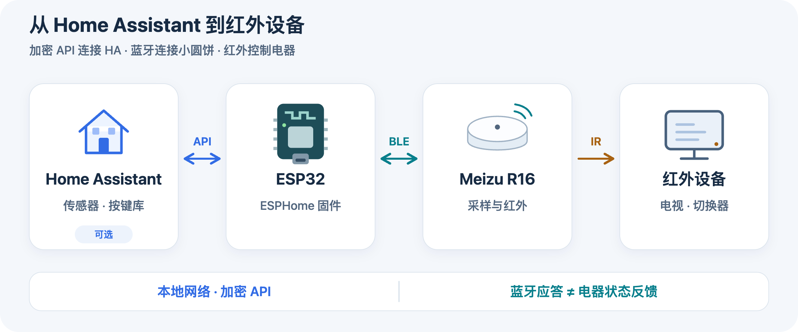
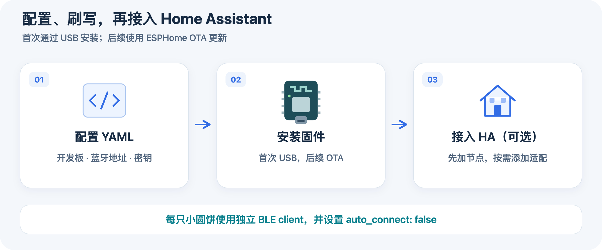
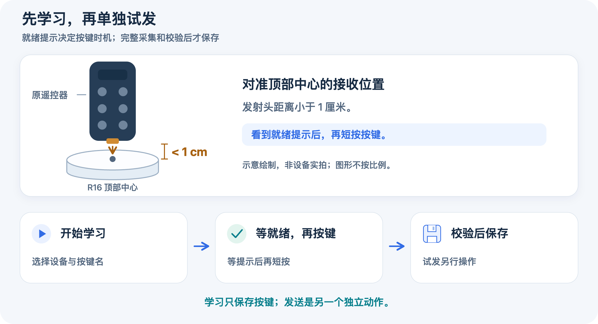

# ESPHome Meizu BLE

[English](README.md) | **简体中文**

用运行 ESPHome 的 ESP32，把魅族 R16 红外小圆饼接入 Home Assistant：读取温湿度、学习遥控器按键，并通过局域网发送已保存的红外指令。

本项目提供 **ESPHome 外部组件**，以及可选的 **Home Assistant 适配**。ESPHome 负责蓝牙、Wi-Fi、加密原生 API 和 OTA；HA 适配提供逐键学习向导和命名按键库。

**实验版本：**组件 **0.1.0**，HA 适配 **1.5.0**。查看 [v0.1.0 发布页](https://github.com/hallucigenia/esphome-meizu-ble/releases/tag/v0.1.0)。

[](docs/images/connection-zh-CN.png)

*连接原理示意，设备外观为示意绘制；点击图片可放大。*

## 功能

- **传感器：**温度、湿度、估算电量、电池电压、蓝牙信号、样本年龄和测量可用性。
- **红外控制：**发送已保存的按键，等待小圆饼的蓝牙应答；缓存缺失时可重新上传完整码。
- **学习：**采集并转换红外按键，支持就绪提示、超时和取消；HA 适配提供逐键向导。
- **本地运行：**支持 ESPHome 自动化和 HA 遥控动作，运行时无需原厂 App、云服务或 HA 主机蓝牙。

## 使用条件

| 项目 | 支持或已验证的配置 |
| --- | --- |
| 小圆饼 | 魅族 R16，已完成一只设备的实机验证 |
| ESP32 | ESP32-D0WD rev1.0、4 MB Flash 已实测；ESP32-C3 已通过 CI 编译 |
| ESPHome | 已验证 2026.10.2 / ESP-IDF 5.5.6，须使用 ESP-IDF 框架 |
| Home Assistant | 可选，适配已在 HA 2026.11.1 验证 |

每只小圆饼使用独立的 `ble_client`，并设置 `auto_connect: false`。使用期间，避免手机或其它网关持续占用同一只小圆饼的蓝牙连接。

## 安装 ESPHome 组件

[](docs/images/setup-zh-CN.png)

1. 从[完整 ESP32 配置](examples/esphome-meizu.yaml)开始。克隆仓库时，示例使用本地组件路径；若复制到 ESPHome Device Builder，请将其中的 `external_components` 替换为已发布的版本：

   ```yaml
   external_components:
     - source: github://hallucigenia/esphome-meizu-ble@v0.1.0
       components: [meizu_ble]
   ```

2. 将[密钥模板](examples/secrets.example.yaml)中的四项加入设备配置旁的私有 `secrets.yaml`，填写自己的 Wi-Fi 信息、新生成的 32 字节 Base64 API 加密密钥和 OTA 密码。

3. 将示例 MAC `02:00:00:00:00:01` 替换为小圆饼的实际蓝牙 MAC，并选择自己的 ESP32 开发板。保留示例中的 ESP-IDF 框架和 `auto_connect: false`。

4. 通过 ESPHome 编译、安装。默认每五分钟采样一次，可设置为 1–30 分钟的整数分钟。失败后自动退避重试，测量可用性与样本年龄用于判断数据是否新鲜。

从其它固件迁移时，先完整备份 Flash 并核对实际分区，再通过 USB 安装。旧网关的 OTA 格式与 ESPHome 不同；迁移后的更新使用 ESPHome OTA。

## 接入 HA 学习向导与按键库

HA 的标准 ESPHome 集成提供传感器和固件更新。需要学习向导和命名按键时，安装本项目的 HA 适配：

1. 先在 Home Assistant 中添加 ESPHome 节点。
2. 从[发布页](https://github.com/hallucigenia/esphome-meizu-ble/releases/tag/v0.1.0)下载 `meizu_remoter_gateway-1.5.0.zip`，或复制 [`custom_components/meizu_remoter_gateway/`](custom_components/meizu_remoter_gateway/) 目录，放入 HA 的 `/config/custom_components/`，然后重启 HA。覆盖已有安装前，先备份原组件目录和运行数据。
3. 添加「**魅族蓝牙网关**」集成，选择「**ESPHome 蓝牙组件**」，选中对应的 ESPHome 设备。使用完整示例时，填写：

   | 字段 | 示例 |
   | --- | --- |
   | ESPHome 动作名 | `meizu_gateway_meizu_puck`，不含 `esphome.` 前缀 |
   | 组件 `api_service` | `meizu_puck` |
   | 小圆饼蓝牙 MAC | 自己设备的实际蓝牙 MAC |

   动作名以 HA 开发者工具中的实际名称为准。配置时只验证一次状态往返，不发射红外。

### 学习按键

[](docs/images/learning-zh-CN.png)

在魅族集成的「**配置**」中打开逐键向导，填写设备名与按键名。把原遥控器发射头对准小圆饼顶部中心，距离小于 1 厘米；**等到就绪提示后，再短按按键。**

也可以调用 HA 标准动作。以下实体 ID 请替换为自己的遥控实体：

```yaml
action: remote.learn_command
target:
  entity_id: remote.meizu_puck
data:
  device: tv
  command: power
  command_type: ir
  timeout: 15
```

完整采集、ESP32 与 HA 转换结果一致且持久化成功后，按键才会保存。学习本身不发射；需要操作电器时，另行点击向导的试发或发送已保存的按键。关闭向导会取消学习。

### 发送或删除按键

```yaml
action: remote.send_command
target:
  entity_id: remote.meizu_puck
data:
  device: tv
  command: power
```

删除时使用 `remote.delete_command`，传入相同的 `device` 和 `command`。适配收到匹配的蓝牙应答后才确认发送成功，超时不会自动重发。小圆饼应答不能代表被控电器的当前状态。

## 从已有魅族集成迁移

先备份 HA 组件目录和按键库。对已有条目使用「**重新配置 → ESPHome 蓝牙组件**」，选择同一只小圆饼的 MAC，可保留遥控实体身份和已保存按键。HA 集成域名继续使用 `meizu_remoter_gateway`。

传感器和固件更新实体转由标准 ESPHome 集成提供，需要核对仪表盘和自动化中的实体引用。每个适配条目对应一只小圆饼；旧多设备网关迁移时，需分别规划条目。

## 验证范围与当前限制

已在一只 R16 和上表中的 ESP32 上验证真实采样、学码及电器响应、取消、超时、原生 OTA 和断电恢复。迁移保留了原遥控实体及九个已保存按键。

其它小圆饼型号、空调长码、长期稳定性和完整 Flash 恢复仍未完成实机验证。CI 覆盖主机回归、真实 HA 事件与服务处理，以及 ESP32、ESP32-C3 和无 API 三种构建。

## 文档与开发

- [组件参考（英文）](components/meizu_ble/README.md)：全部传感器、本地动作、API 事件和协议限制。
- [HA 适配指南](custom_components/meizu_remoter_gateway/README.md)：学习、按键存储及服务说明。
- [开发与测试（英文）](CONTRIBUTING.md)：开发环境和检查命令。

## 许可与鸣谢

本仓库源码采用 [MIT 许可证](LICENSE)，保留 **George Zhao** 与 **hallucigenia** 的版权声明。感谢 George Zhao 的[原始网关及设备、协议研究](https://github.com/georgezhao2010/esp32_meizu_remoter_gateway)，以及 [MIT 授权的 HA 集成](https://github.com/georgezhao2010/meizu_remoter_gateway)。

ESPHome 与其它依赖保留各自的许可证。其中 ESPHome C++ 运行时采用 GPLv3，分发编译后的固件时，还需遵守相应依赖的许可要求。完整来源与许可范围见 [NOTICE.md](NOTICE.md)。
